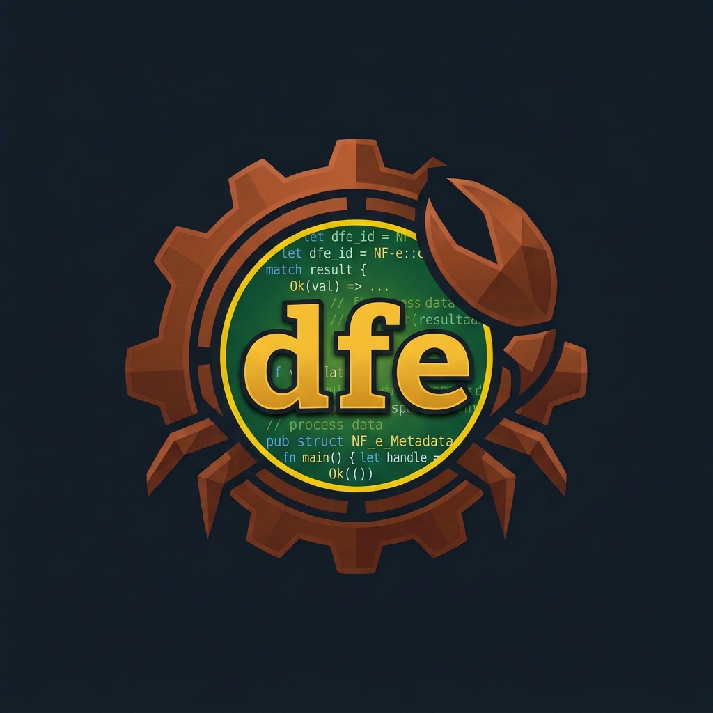

<p align="center">
  
</p>

# dfe

**Documentos Fiscais Eletrônicos Brasileiros em Rust** — NF-e, NFC-e e NFS-e Nacional: emissão,
eventos, assinatura, validação, DANFE e impressão, numa única biblioteca `async`, com as 27 UFs,
no Windows e no Linux.

*Brazilian electronic fiscal documents for Rust: NF-e, NFC-e and NFS-e — issuing, events,
XML signing, schema validation, DANFE and ESC/POS printing against SEFAZ.*

[](https://crates.io/crates/dfe)
[](https://docs.rs/dfe)
[](LICENSE)
[](https://github.com/sponsors/GustavoOta)
[](https://chat.whatsapp.com/GYV2d62n46k7vYaZg5zRBb)

---

## Por que a dfe

- **Builders fluentes e tipados.** Você monta a nota com structs Rust; a crate calcula os totais,
  assina, valida no XSD, escolhe o webservice da UF e devolve a resposta da SEFAZ tipada.
- **Reforma Tributária pronta.** IBS/CBS por item e nos totais, DANFE A4 no modelo da NT 2026.010
  e CNPJ alfanumérico.
- **Certificado A1 sem dor de cabeça.** Assinatura XML-DSig e TLS mútuo resolvidos por dentro,
  inclusive com os PFX ICP-Brasil antigos (RC2/3DES).
- **Windows e Linux, mesmo resultado.** CryptoAPI no Windows (sem OpenSSL), OpenSSL no Linux — a
  assinatura sai idêntica byte a byte.
- **Testada contra a SEFAZ de verdade.** NF-e e NFC-e autorizadas, corrigidas e canceladas em
  homologação nos dois sistemas; testes que falam com a SEFAZ ficam travados em homologação.
- **Só o que você usar.** DANFE, ESC/POS, distribuição e NFS-e são *features* de compilação.
- **Erros tipados, sem `panic`.** Toda operação devolve `Result<T, DfeError>`.

---

## O que cobre

| Área | O que faz |
|---|---|
| **NF-e (55)** | Emissão (direta ou em duas etapas, com a chave antes do envio), cancelamento, carta de correção, inutilização, consulta de situação, status do serviço |
| **NFC-e (65)** | Emissão (inclusive contingência off-line), cancelamento, cancelamento por substituição, QR Code |
| **NFS-e Nacional** | DPS v1.01 de MEI e Simples Nacional, assinatura, envio e consulta na SEFIN Nacional (*feature* `nfse`) |
| **Ambiente Nacional** | Distribuição de DF-e por NSU ou chave, manifestação do destinatário |
| **Tributos** | Todos os grupos de ICMS (Simples e regime normal, ST, DIFAL, partilha, monofásico), IPI, PIS/COFINS de qualquer CST, IBS/CBS |
| **Impressão** | DANFE em PDF (A4 paginado com logotipo opcional, ou 80 mm), cupom da NFC-e e DANFE simplificado em ESC/POS |
| **Infraestrutura** | 27 UFs em produção e homologação, XSD oficiais embutidos, validação de CNPJ/CPF, leitura de XML autorizado |

**Cobertura:** todos os serviços do dia a dia da SEFAZ (autorização, consulta, inutilização,
status, distribuição, cancelamento, substituição, CC-e e manifestação) e os grupos do leiaute do
varejo, com DANFE, ESC/POS e NFS-e na mesma crate. Ainda faltam EPEC, consulta cadastro, eventos
de entrega e da Reforma e grupos como importação, exportação e cobrança — tabela item por item
em [Cobertura](docs/cobertura.md).

Referência completa: [API.md](API.md). Próximos passos: [roadmap](docs/notas-roadmap.md).

---

## Início rápido

```toml
[dependencies]
dfe = "0.8"
```

```rust no_run
use dfe::{NFeBuilder, DfeError};
use dfe::tipos::{Det, Emit, Icms, Ide, Pag, Pis, Cofins, Total, Transp};

async fn emitir() -> Result<(), DfeError> {
    let resp = NFeBuilder::new()
        .cert("./cert.pfx", "senha")
        .ide(Ide { c_uf: 35, mod_: 55, serie: 1, n_nf: 1, tp_amb: 2, ..Default::default() })
        .emitente(Emit { cnpj: Some("11111111111111".into()), ..Default::default() })
        .itens(vec![Det {
            c_prod: "001".into(), x_prod: "PRODUTO".into(), ncm: "22030000".into(),
            cfop: 5102, q_com: 1.0, v_un_com: 10.0, v_prod: 10.0,
            icms: Icms::sn102(0, "400"),
            pis: Pis::Nt { cst: "07".into() },
            cofins: Cofins::Nt { cst: "07".into() },
            ..Default::default()
        }])
        .total(Total::default())
        .transporte(Transp::default())
        .pagamento(Pag::default())
        .emitir()
        .await?;

    println!("cStat: {}", resp.protocolo.inf_prot.c_stat);
    Ok(())
}
```

> **Windows:** configure o vcpkg para o `libxml2` estático — [Instalação](docs/instalacao.md).
> OpenSSL não é dependência. **Linux:** `pkg-config`, `libssl-dev` e `libxml2-dev`.

### DANFE

```rust no_run
async fn danfe(xml_autorizado: &str) -> Result<String, String> {
    dfe::DanfeBuilder::new()
        .xml(xml_autorizado)   // conteúdo do nfeProc ou caminho de um .xml
        .paper_size("a4")      // ou "80mm"
        .as_base64()           // ou .as_file("danfe.pdf")
        .build()
        .await
}
```

Quer ver o resultado sem certificado? `cargo test --test danfe_a4_amostras -- --nocapture` gera
seis DANFEs A4 de exemplo no modelo da Reforma — detalhes em [DANFE](docs/danfe.md).

### NFS-e Nacional

```toml
dfe = { version = "0.8", features = ["nfse"] }
```

```rust no_run
use dfe::nfse::{Ambiente, DpsGerada, NfseClient, ResultadoEmissao};

async fn emitir_nfse(dps: DpsGerada) -> Result<(), Box<dyn std::error::Error>> {
    // dps = NfseBuilder::new()…gerar_dps()? — ver docs/nfse.md
    let cliente = NfseClient::builder()
        .ambiente(Ambiente::ProducaoRestrita)
        .cert("./cert.pfx", "senha")
        .build()?;
    let assinada = cliente.assinar(&dps).await?; // guarde assinada.id() antes do envio
    match cliente.transmitir(&assinada).await? {
        ResultadoEmissao::Autorizada(nfse) => println!("chave {}", nfse.chave_acesso),
        ResultadoEmissao::Rejeitada(r) => println!("rejeitada: {:?}", r.erros),
    }
    Ok(())
}
```

Ambientes, adesão do município e problemas conhecidos: [NFS-e Nacional](docs/nfse.md).

---

## Plataformas

| Sistema | Certificado e assinatura | TLS com a SEFAZ | Situação |
|---|---|---|---|
| **Windows** | CryptoAPI do sistema | SChannel | ✅ em produção |
| **Linux** | OpenSSL do sistema + provider `legacy` | OpenSSL + cadeia ICP-Brasil embutida | ✅ desde a 0.8 |
| **macOS** | — | — | ⚠️ não testado |

Como cada parte funciona e por quê: [Certificado digital e plataformas](docs/certificado-e-plataformas.md).

---

## Features de compilação

| Feature | Liga | Padrão |
|---|---|:--:|
| `emissao` | Montagem, assinatura e transmissão de NF-e/NFC-e com validação XSD | ✅ |
| `danfe` | DANFE em PDF | ✅ |
| `escpos` | ESC/POS genérico e cupons fiscais | ✅ |
| `distribuicao` | Distribuição de DF-e e manifestação | ✅ |
| `nfse` | NFS-e Nacional | opt-in |
| `validacao-xsd` | Só a validação XSD (`is_xml_valid`) | via `emissao` / `nfse` |
| `escpos-base` | Só o `EscPosBuilder` genérico | via `escpos` |

```toml
# Só emissão + DANFE, sem ESC/POS nem distribuição:
dfe = { version = "0.8", default-features = false, features = ["emissao", "danfe"] }
```

Perfis (inclusive um sem `libxml2`) e o que fica sempre disponível: [Instalação](docs/instalacao.md#features-de-compilação).

---

## Documentação

| Página | Conteúdo |
|---|---|
| [Instalação](docs/instalacao.md) | Plataformas, `libxml2`/vcpkg no Windows, perfis de *features* |
| [Certificado digital e plataformas](docs/certificado-e-plataformas.md) | CAPI × OpenSSL, provider `legacy`, cadeia ICP-Brasil, macOS |
| [Emissão NF-e / NFC-e](docs/emissao-nfe-nfce.md) | `NFeBuilder`, métodos, totais automáticos |
| [ICMS, PIS, COFINS](docs/icms-pis-cofins.md) | Grupos de ICMS, PIS/COFINS, IPI, validação de CNPJ/CPF |
| [Cancelamento](docs/cancelamento.md) | `CancelarBuilder` |
| [Manifestação do destinatário](docs/manifestacao.md) | Ciência, confirmação, desconhecimento, operação não realizada |
| [Distribuição de DF-e](docs/distribuicao.md) | Consulta por NSU e chave de acesso |
| [NFS-e Nacional](docs/nfse.md) | Ambientes, adesão do município, exceção do MEI, diagnóstico de acesso |
| [DANFE](docs/danfe.md) | PDF A4 e 80 mm, modelo da Reforma, amostras |
| [ESC/POS](docs/escpos.md) | `EscPosBuilder`, `EscPosNFCeBuilder` |
| [Status do webservice](docs/status-webservice.md) | Disponibilidade por UF e modelo |
| [Tratamento de erros](docs/erros.md) | `DfeError`: variantes e quando ocorrem |
| [Cobertura](docs/cobertura.md) | Serviços da SEFAZ, grupos do leiaute e contingência, item por item |
| [Testes](docs/testes.md) | Suítes, requisitos, homologação ao vivo |
| [Pacotes XSD](docs/xsd_pacotes.md) | Pacote em uso, troca e rollback |
| [Notas e roadmap](docs/notas-roadmap.md) | Boas práticas e o que vem por aí |
| [API.md](API.md) | Referência de todos os *builders* |

Os exemplos em Rust deste README são compilados no `cargo test --features nfse`.

---

## Comunidade

Dúvidas, sugestões e troca de experiência com quem integra a SEFAZ em Rust: entre na
[comunidade do dfe no WhatsApp](https://chat.whatsapp.com/GYV2d62n46k7vYaZg5zRBb).
Bugs e pedidos de funcionalidade: [issues do GitHub](https://github.com/GustavoOta/dfe/issues).

## Agradecimentos

Agradeço às comunidades do [SPED-NFe (NFePHP)](https://github.com/nfephp-org/sped-nfe)
e do [Projeto ACBr](https://projetoacbr.com.br/sobre/) por compartilharem, há anos,
documentação, exemplos e experiência com documentos fiscais eletrônicos no Brasil.
Esses projetos foram referências técnicas importantes no desenvolvimento da `dfe`.

Agradeço também à Receita Federal por disponibilizar publicamente as calculadoras
da Reforma Tributária do Consumo e o gerador oficial de DANFSe. Iniciativas assim
facilitam a vida de quem desenvolve software fiscal. Ter ferramentas oficiais
abertas à consulta ajuda a entender as regras, tirar dúvidas e avançar com mais
segurança na implementação.

- [Calculadora de Tributos — Regime Regular](https://github.com/ReceitaFederal/calculadora-rtc-regime-regular)
- [Calculadora de Tributos — Simples Nacional](https://github.com/ReceitaFederal/calculadora-rtc-simples-nacional)
- [DANFSe Service](https://github.com/ReceitaFederal/calculadora-rtc-gerador-danfse)

O SPED-NFe é uma biblioteca muito robusta, escrita em PHP, e um ótimo trabalho
do Roberto Machado. Um dos motivos que me levaram ao Rust foi a possibilidade
de criar aplicações desktop nativas.

Peraí, mas o ACBr também é desktop! Pois é. O ACBr, criado pelo Daniel Simões
de Almeida, é outro projeto que admiro. Ele foi escrito em Object Pascal, com
suporte a Delphi e Lazarus. Uma vantagem que vejo nessa linguagem é dispensar
um coletor de lixo (*garbage collector*).

Pra ser sincero, eu me sinto mais à vontade programando em Rust, e foi por isso
que escolhi a linguagem para desenvolver a `dfe`. Espero que a crate seja
útil. Valeu!

## Licença

MIT — veja [LICENSE](LICENSE).
